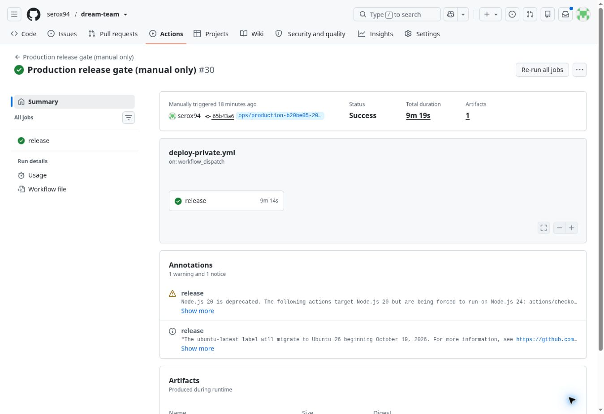

# Production release — 2026-10-13

DEPLOYMENT: SUCCESS

- Approved application commit: `b20be0508b8f2aafdd16f31118ab4dbbae2492a0`; main unchanged.
- Active production Worker: `4170c749-a114-4075-ba7b-be0e7e8dee25` (100% traffic verified in the release).
- Manual workflow_dispatch: https://github.com/serox94/dream-team/actions/runs/38461212509 — SUCCESS.
- Operator commits: 5b8d26b, 03d4f09, 65b43a6. Only workflow/operational files changed; deployed application sources remain b20be05.
- Current Cloudflare/GitHub concurrency gate: PASS. Cloudflare Builds and automatic release triggers were not enabled.
- Existing password/username/session-secret equality verified with the production login and HMAC, without disclosure (38459921007); secrets not rotated.
- Global HTTP/write/cron maintenance barrier installed. First run stopped before migration when the initial bookmark differed; no business/media data writes. Resume verified the retained barrier and compared the exported snapshot against the stable post-export bookmark and live database.
- Fresh private D1 checkpoint: PASS, 19 tables / 361 rows including the maintenance setting; bookmark retained privately. SHA-256: `d73641be47ae7901bd79f2eb85b26e3d95e243d4f49d35c7b062aec858dd920a`.
- Fresh private R2 inventory/copy and isolated restore: PASS, 0 original objects. Frozen archive was not overwritten; source verification is read-only.
- Fresh D1 restore into a new isolated Cloudflare database: PASS (schema, all rows/IDs, FK, integrity, sequences).
- Explicit production migration 20→28 using the existing receipt-guarded release operator: PASS. Original columns/records/IDs/PB/catches/checklists/archive preserved; foreign keys checked before/after.
- Individual account mappings: Patryk→existing patryk, Maciek→existing maciek; shared password preserved. Active-account cap remains 3. Legacy sessions physically purged; test logout cookies return 401.
- Private operator smoke against the production database while public HTTP/cron stayed behind the no-op maintenance Worker: PASS.
- Exact candidate deployed with reviewed flags, original secret bindings/provider variables, and production D1/R2: PASS.
- Live production smoke: both logins/logout, account identity/catch author, protected APIs/writes, dashboard/trips/all trip catches/checklists/archive reads, Settings PL→EN→PL/reload, 390px and 1280px without overflow/page errors: PASS. No test business records were inserted/changed.
- Final business-data/FK/R2 equality: PASS. No Tavily or Workers AI calls. Previous Validate/Responsive/application audit suites were not repeated.
- Maintenance: OFF. Final private manifest and schema28 snapshot retained. Disposable D1/Workers cleaned; private archives retained.
- No automatic historical rollback. Any recovery requires maintenance, a verified isolated target, data reconciliation, compatible schema/config, and physical session purge before reopening.
- No user action required. Stop after release; no further deployment/merge authorized by this checkpoint.

