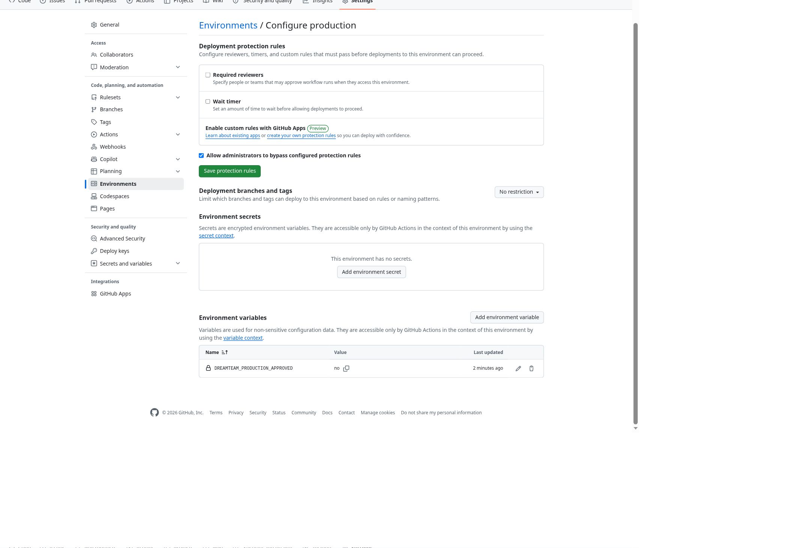

# DreamTeam — ukończenie oficjalnego wydania PR #19

DEPLOYMENT: SUCCESS

- Main / merge PR #19: `372b088251f72c9f1447922ce2067afcc3a5aed6`.
- Zatwierdzony operator: `dee8f231693cc7779b39aa628990b24e7e4ef37d`.
- Kod aplikacji: zatwierdzony `db4190d2f8836786e25656807c1417b42118880e`; APP_BUILD `2b38f99fda6c4c231d2abcaa0ac7c8ef69d77333`.
- Aktywny pełny Worker: `de1408b8-08d8-4253-ba41-c0288d09cf65`, 100% ruchu.
- Produkcja: https://dream-team.sewerynski00.workers.dev/
- Schema / rejestr migracji: 31 / 31. Nie uruchomiono migracji.
- Maintenance: OFF. Jednorazowa zgoda DREAMTEAM_PRODUCTION_APPROVED: no, odczyt po odświeżeniu Settings.
- Brak resetów haseł, zmian polityki logowania lub poświadczeń i czyszczenia istniejących sesji.
- Main ma dokładnie to samo drzewo Git co zatwierdzony PR #19; src/public/migrations pozostały zatwierdzonym kodem aplikacji.

## Kontrole i punkt odzyskiwania

1. [40232978576 — check PASS](https://github.com/serox94/dream-team/actions/runs/40232978576): fallback i przypięty kandydat, schema31, integralność, kolejka Builds/hooks/operacje, zasoby i bezpłatny budżet.
2. [40241458807 — prepare PASS](https://github.com/serox94/dream-team/actions/runs/40241458807): jeden świeży eksport schema31, rzeczywiste odtworzenie w osobnej bazie, prywatny R2 roundtrip zgodny z sumą kopii, bieżący Time Travel bookmark i prywatny baseline. Zbiór mediów R2 pusty — potwierdzony, bez danych do kopiowania.
3. [40241636289 — promote SUCCESS](https://github.com/serox94/dream-team/actions/runs/40241636289): jedno przełączenie istniejącej wersji; gotowość na dwóch zgodnych obserwacjach HTTP i Cloudflare API. Login200/build2b38, pełny endpoint401 zamiast fallback503. Konta, poświadczenia, oryginalne sesje i rekordy zachowane; usunięto wyłącznie własne tymczasowe sesje smoke. Nie było odzyskiwania ani drugiej próby aktywacji.
4. [40232948620 — Validate SUCCESS](https://github.com/serox94/dream-team/actions/runs/40232948620). Wcześniejsze testy izolacji i niezmienionej aplikacji zachowano, bez ponawiania audytów i researchu.

## Odbiór rzeczywistej produkcji

[40241844684](https://github.com/serox94/dream-team/actions/runs/40241844684) ma status FAILURE: **26 konkretnych kontroli PASS**, ale ostatni test desktop/EN próbował użyć nieistniejącego selektora. Nie oznaczamy całego przebiegu jako PASS. Potwierdzone: loginy Patryk/Maciek/Paddy, oddzielne tożsamości, brak wymuszonej zmiany, integralność, Start, checklisty, Pogoda i godzinowy indeks karpiowy, połowy, Google Photos, archiwum Adventure2025, osiem zapisanych stron researchu, Light/Dark, brak overflow/JS na głównych ekranach390px, realny offline reload/PWA z zachowaniem sesji.

Dwa uzupełniające przebiegi 40242153008 i 40242341235 również jawnie FAIL na selektorze języka; desktop/integralność/login przeszły. Naprawiono **sam test**: rzeczywisty przełącznik w Pogodzie jest przyciskiem EN, a nie starym select ani przyciskiem na checkliście.

[40242517755 — końcowe uzupełnienie PASS](https://github.com/serox94/dream-team/actions/runs/40242517755): realne kliknięcie EN w Pogodzie, zapamiętanie EN po przejściu do checklisty, Dark EN i desktop1440 bez overflow. Powtórzono brakujący fragment; wcześniejszych 26 PASS nie zastąpiono fikcyjnym pełnym zielonym runem. Skrypt i dowody są na osobnej gałęzi operacyjnej, nie zmieniają produkcyjnego kodu.

## Dane i harmonogramy

- 5 wyjazdów; 3 połowy; 103 pozycje checklist; 4 konta; 3 oryginalne sesje; 402 ukończone translation_jobs.
- Kontrole FK i quick_check: PASS. Oryginalne poświadczenia i sesje porównano prywatnie w operatorze przed/po.
- Główny cron: `0 6 * * *` UTC; niezależny backup: `17 3 * * *` UTC. Konfiguracje niezmienione; backup-health40178522808 SUCCESS.
- Pełny scheduled handler wraca wraz z pełną wersją (przetestowany w izolacji). Pierwszy następny planowy przebieg produkcyjny po aktywacji jeszcze nie nastąpił; nie raportujemy go jako już wykonanego.
- Kontrole SELECT/PRAGMA: check3985, prepare4507, promote5099 i każdy odbiór4474 rows_read. Jedyny eksport należał do świeżego checkpointu. Brak nowej ekstrakcji Tavily, benchmarków AI lub aktywacji płatnych usług.
- Nie ponawiano migracji 0031, starego workflow39905061217 ani schematu30 rollback.
- Zatwierdzony schema31 fallback pozostaje dostępny; podczas tej udanej aktywacji nie trzeba było go przywracać.

