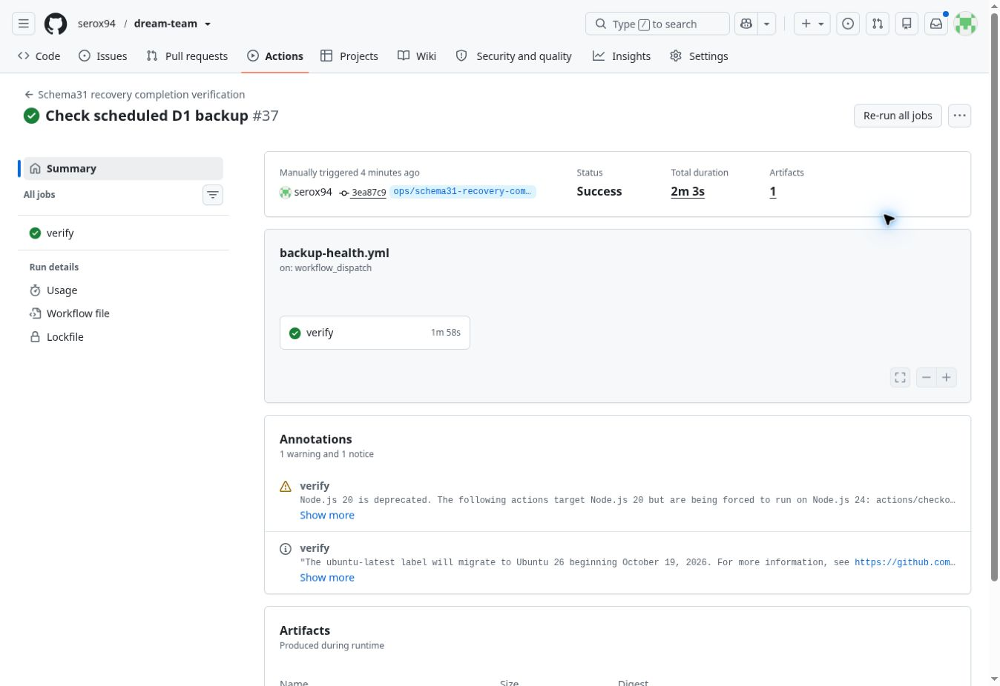

# DreamTeam — recovery completion, 23.10.2026

Produkcja nie została przełączona. `DREAMTEAM_PRODUCTION_APPROVED=no` odczytano
w GitHub Settings bez edycji. Nowy operator pozostaje na osobnej gałęzi
`ops/schema31-recovery-completion-20261023`.

## Wersje i zakres

| Element | Potwierdzony stan |
|---|---|
| Zatwierdzona aplikacja | `db4190d2f8836786e25656807c1417b42118880e` |
| Produkcyjny main | `2b38f99fda6c4c231d2abcaa0ac7c8ef69d77333` |
| Aktywna wersja `dream-team` | `21a90928-ac5c-4ea6-9101-8fbf4b0498e0`, `schema31-fallback` |
| Przypięta pełna wersja | `de1408b8-08d8-4253-ba41-c0288d09cf65` |
| Produkcyjny schemat / rejestr | 31 / 31 |
| Maintenance | OFF |
| Zachowane rekordy | 5 wyjazdów, 3 połowy, 103 pozycje checklist, 4 konta |
| Sesje / tłumaczenia | 3 oryginalne sesje; 402 ukończone tłumaczenia |
| Zmiany aplikacji | Brak zmian `src/`, `public/`, `migrations/` |

Nowe pliki dotyczą wyłącznie operatora, testów i dowodów. Surowy pobrany bundle
pełnego Workera ma SHA256 `c0bed94853b9691a9fab706aa1372ac11629f228c1204bb3e57c4d60bcf7ff21`.
Porównanie z przebudowanym zatwierdzonym źródłem po usunięciu komentarzy i
formatowania potwierdziło identyczny kod wykonywalny. Promocja używa istniejącego
UUID, bez przebudowy produkcyjnej aplikacji.

## Diagnoza oryginalnego zatrzymania

**ROOT CAUSE CONFIRMED: NO.** Logi i pobrany artefakt runu
[39905061217](https://github.com/serox94/dream-team/actions/runs/39905061217)
nie zawierają otrzymanego statusu, SHA ani Ray ID. Operator odrzucił pojedynczą
odpowiedź `/login`; nie da się rzetelnie ustalić, który z dwóch warunków zawiódł.
Odczyt historycznych Workers Logs zwrócił 403 / kod Cloudflare 10000. Nie
rozszerzano uprawnień ani nie zmieniano konfiguracji logowania.

Obecnie adres przypiętej wersji odpowiada 200 z właściwym buildem. Binding
ASSETS, `run_worker_first=true`, `html_handling=none`, APP_BUILD, indywidualne
konta i wspólna polityka wędkarzy są poprawne. Rzeczywisty `ensureSchema()`
akceptuje produkcyjną D1 31. Stary Node GET nie przekazywał cookies; możliwe
przekierowanie zalogowanego użytkownika nie jest dowodem przyczyny tej awarii.

Potwierdzono natomiast w izolowanych próbach, że control plane może już
wskazywać pełny UUID, podczas gdy odpowiedź endpointu nadal pochodzi z
fallbacku. W runie 39934361782 gate rozpoznał taki stan mimo HTTP 200 i tego
samego APP_BUILD, a pełną wersję zaakceptował dopiero po zgodnych odpowiedziach.
Nie utożsamiamy tego odtworzonego zjawiska z nieudokumentowaną odpowiedzią z
oryginalnego wydania.

Do potwierdzenia historycznej przyczyny potrzebny jest odczyt istniejących
zapisanych logów `dream-team` z 23.10.2026, 07:22:44–07:22:51 czasu Amsterdamu.
Brak takich zapisów oznacza, że pierwotna odpowiedź pozostanie nieustalona.

## Wyniki zakończonej weryfikacji

[Run 39939111862 — SUCCESS](https://github.com/serox94/dream-team/actions/runs/39939111862),
przetestowany kod operatora: `3ea87c97d3f89679d8e01788b190c8917b2f1a54`.
Końcowe zmiany dokumentacji i przeniesienie identycznego workflow do osobnego
pliku nie zmieniają przetestowanych skryptów ani aplikacji.

- 30/30 regresji operatora: opóźnienie control plane, poprzedni wariant,
  niewłaściwy/brakujący SHA, 302/404/500/503, timeout, rzeczywista awaria,
  odmowa promocji bez nowej zgody, odzyskiwanie, brak danych bazowych i zmiana
  rekordu. Fallback z poprawnym APP_BUILD nie daje fałszywego PASS.
- 28/28 kontroli rzeczywistej integracji: Patryk/Maciek/Paddy, odrębne tożsamości,
  stare i nowe sesje, błędne hasło, brak wymuszonej zmiany, ochrona konta,
  istniejący research ośmiu stron, Adventure 2025, album next-trip, zapis D1,
  powtórzenie offline bez drugiej rewizji/duplikatu, scheduled handler i dane.
- 10/10 kontroli Chromium: Checklista, Pogoda PRO i Połowy, brak overflow/JS
  errors, aktualna temperatura i godzinowy indeks, Photos CTA, Light→Dark,
  reload offline/PWA z zachowaną tożsamością.
- Realne `fallback → full`: PASS; wstrzyknięta awaria po aktywacji i realny
  powrót wyłącznie do schema31 fallback: PASS; ponowna promocja w izolacji: PASS.
- Końcowe porównanie prywatnych oryginalnych rekordów produkcyjnych: PASS.
  Pierwotne 3 sesje kopii zachowano, własne sesje QA usunięto.
- Poprzednia kompletna macierz PL/EN, Light/Dark, 390/1440 oraz wizualna pozostaje
  ważna dla identycznej aplikacji: 39902213393, 39902213286, 39902208041. Nie
  wykonywano nowej ekstrakcji Fishing Adventure ani audytu wizualnego.

Próby nieudane w toku dopracowywania harnessu zachowano jako FAIL. Dotyczyły
nazwy wejściowego modułu fallbacku, dostępności prywatnej bramki po zmianie
wersji, założenia o wartości zastanych poświadczeń, tekstowego kontraktu pola
ilości i końcowego raportowania porównania danych. Kontroli aplikacji nie
pominięto. Ostateczny przebieg powyżej przeszedł cały zestaw.

## Koszty i zachowanie danych

Ostatni odczyt budżetu przed zakończoną próbą: 254474 / 5 mln dziennych odczytów.
W tym workflow inspekcja zużyła 588 odczytów D1, tryb `check` operatora 3985,
rehearsal 5369 produkcyjnych odczytów i 10724 izolowanych (w tym Chromium).
Nagłówkowe probe'y są dodatkowo widoczne w logu gotowości. Stosowano rezerwę
60k i próg zatrzymania 4,8 mln; nie uruchamiano eksportów produkcji.

Produkcja: 0 zapisów tego zadania, 0 migracji, 0 zmian maintenance, 0 resetów
haseł, 0 czyszczeń sesji, 0 importów QA. AI/Tavily: 0 wywołań. Istniejący cache
i 402 tłumaczenia zachowano. Nie zastępowano D1 preview nową kopią produkcji.
Główne scheduled work wznowiono i sprawdzono tylko w izolacji; produkcyjny
fallback nadal je wstrzymuje. Niezależny harmonogram backupu pozostał identyczny.

## Ograniczenia odbioru i następny krok

Właścicielowi zgłoszono zastaną niezgodność separacji poświadczeń konta
technicznego. Niezależny rekord i ochrona przed zmianą konta są zachowane;
nie jest to automatycznie dowód odrębnej wartości hasła. Szczegóły przekazano
prywatnie, bez zmieniania haseł, sesji i zatwierdzonej aplikacji.

**Wydanie pozostaje wstrzymane do decyzji właściciela i nowej zgody.**
Procedura i odzyskiwanie są opisane w
[SCHEMA31_PROMOTION.md](../release/SCHEMA31_PROMOTION.md). Używa nowego receipt,
świeżego schema31 backup/restore dopiero po nowej zgodzie, dokładnych UUID i
nowej bramki. Nie wykonuje 0031 ponownie ani rollbacku schematu.

